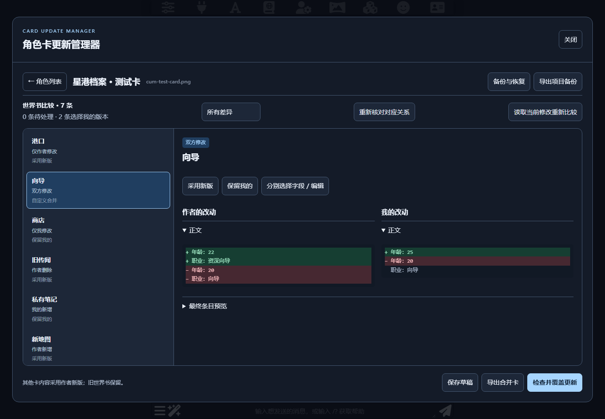

# 角色卡更新管理器

在 SillyTavern 中先比较作者新版与个人修改，选择保留内容，再覆盖更新角色卡。

**0.1.0 首版预览**。独立前端扩展，不依赖酒馆助手，不需要额外模型 API 或服务器插件。



## 安装与更新

在酒馆的「扩展 → 安装扩展」中粘贴：

```text
https://github.com/adelia1017/sillytavern-card-update-manager
```

安装后刷新页面，从「扩展设置 → 角色卡更新管理器」打开，也可从聊天区的扩展菜单进入。
后续通过酒馆扩展管理中的更新按钮获取更新，再刷新页面。不需要 npm install 或编译。

如需手动安装，把包含 `manifest.json` 的整个文件夹放入酒馆的 `data/<账号>/extensions/card-update-manager/`，然后刷新。手动复制安装不会自动成为可 Git 更新的安装，日常使用建议通过仓库链接安装。

## 使用流程

1. 打开管理器，搜索并选择角色卡。选择管理对象不会切换当前聊天。
2. 首次导入「作者旧原版」：必须是你开始修改前使用的原版 PNG 或 JSON 卡。
3. 导入作者新版。扩展读取当前角色实际使用的主要世界书，三方数据都齐备后开始比较。
4. 核对条目对应关系。唯一名称、正文或关键词用于预匹配；改名、拆分、重建条目可能需要人工调整。未对应的条目作为新增或删除处理。
5. 查看分类差异，按条目选择「采用新版」「保留我的」，也可以分别选择字段并编辑正文。
6. 可以保存草稿、导出合并 PNG 卡，或点击「检查并覆盖更新」。
7. 更新前保存恢复快照；更新后检查卡内容、世界书和聊天关联，成功后刷新酒馆。未经个人修改的作者新版自动成为下次比较的基线。

## 比较规则

| 类别 | 默认选择 |
| --- | --- |
| 仅作者修改、作者新增 | 作者新版 |
| 仅我修改、我的新增、我的删除 | 我的版本 |
| 作者删除且我没有改 | 接受删除 |
| 双方修改且结果不同、修改与删除冲突 | 必须选择 |
| 双方结果相同 | 采用共同结果 |

正文以增删行显示，关键词、启用状态、顺序、触发设置等以字段显示。整条选择会采用该侧整条内容；需要同时保留不同字段时使用「分别选择字段 / 编辑」。

## 数据与恢复

- 基线、草稿、恢复备份使用浏览器 IndexedDB，按酒馆地址和账号隔离。刷新页面、更新扩展不会主动删除它们；清理站点数据、更换域名或浏览器会失去这份本地记录。
- 使用「导出项目备份」保存可迁移的 JSON 包，里面包含基线、草稿和恢复快照。导入时需与目标角色的实际文件名一致。
- 更新使用原角色卡文件名定位，保留聊天文件关联和收藏状态，不删除聊天文件。
- 合并世界书保存为 `CUM-角色名-唯一标识` 并绑定到目标卡。旧世界书原文件保留，避免覆盖其他角色共用的世界书。
- 「备份与恢复」可导出更新前的卡或恢复旧卡及原世界书绑定。恢复不会撤销后来对旧世界书文件作出的编辑；项目备份中保留当时的世界书数据。
- 更新失败会尝试恢复旧卡。若浏览器或服务器中途断开，重新打开「备份与恢复」查看未完成记录并恢复。
- 比较后如果角色或世界书又被修改，覆盖操作会停止，要求重新读取比较。没有服务器事务锁，更新期间请不要在其他窗口同时编辑同一卡。

## 首版范围

- 支持 V2 / V3 的 PNG 与 JSON 角色卡，要求卡内有世界书；PNG 最大 64 MB，最多 10000 条目。
- 比较角色主要世界书；没有主要绑定时，使用卡内世界书。
- 全局、聊天、人设及附加世界书不参与合并。
- **开场白、描述、正则、脚本和其他角色卡字段采用作者新版，世界书整体元信息也采用作者新版。** 首版不对这些字段进行三方合并。
- JSON 新版没有图片，导出和更新时沿用当前卡图片。PNG 新版使用新版图片。
- 匹配是确定性规则加人工核对，不声称能自动正确识别任意改名、拆分、合并。
- 不支持 CHARX、独立世界书文件导入、自动寻找作者新版和 AI 合并。
- 不会向 GitHub 或第三方上传角色卡；只有酒馆自身的扩展更新功能会访问 GitHub。

## 开发与验证

零生产依赖，浏览器 ES modules。`manifest.json`、入口 JS 和 CSS 位于仓库根目录，可直接由酒馆加载。

```sh
npm test
```

单元测试覆盖三方分类、删除冲突、ID 重排、重复对应拒绝、字段合并、PNG 元数据校验、更新前并发修改检测和故障回退。

真实浏览器集成测试使用隔离的 SillyTavern **1.18.0** 和虚构测试卡，已验证：实际覆盖更新、字段编辑、世界书生效、保留聊天/收藏、基线升级、第二轮比较、恢复旧卡以及桌面/手机布局。

`tests/browser.mjs` 是开发环境集成测试，需自行准备隔离酒馆、Playwright 和 Chrome，并设置 `TEST_URL`、`PLAYWRIGHT_MODULE`、`CHROME_PATH`。不要把它指向日常使用的数据实例。运行产物位于被 Git 忽略的 `test-results/`，不随扩展发布。

其他酒馆版本尚未实测。接口适配集中在 `host.js`。

## 文件结构

- `index.js`：酒馆入口
- `ui.js` / `style.css`：角色列表、条目对应、差异面板和恢复界面
- `core.js`：三方比较与世界书转换
- `card.js`：PNG/JSON 解析与封装
- `host.js`：酒馆接口、备份和更新事务流程
- `storage.js`：本地记录存储
- `tests/`：虚构数据测试

MIT License。
